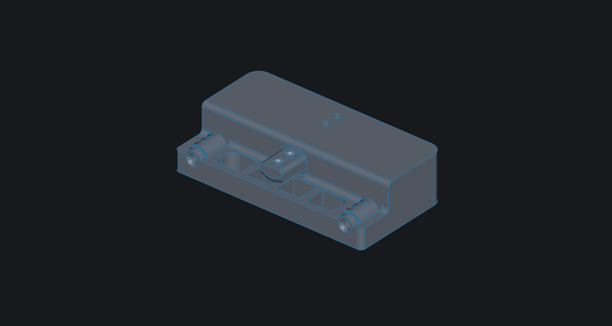

```
 _   _ __  __ ____
| | | |\ \/ /|___ \     two-channel belt tension meter
| |_| | \  /   __) |    for CoreXY printers
|  _  | /  \  / __/
|_| |_|/_/\_\|_____|    A · B · Δ
```

**HX2** measures the tension of both CoreXY belts (A and B) at the same time
and shows you the one number that matters most: **the difference between them (Δ)**.

```
┌────────────────────────┐
│ A        14.82 N   =   │
│ B        15.61 N   =   │
│────────────────────────│
│ Δ        -0.79 N  -5%  │
└────────────────────────┘
```

> **Status: design stage.** The firmware builds and probe v1 is modelled and ready to print,
> but nothing is verified yet. Numbers are calculated, not measured.

---

## Why A/B balance matters on CoreXY

On a CoreXY printer, the toolhead is moved by two belts working together.
X motion is A and B turning the same way, Y motion is them turning opposite
ways. When the belts are evenly tensioned, the two motors share the load
evenly and the gantry moves square.

When A and B have different tension:

- **Skew/racking.** The tighter belt stretches less under load than the looser
  one, so the gantry twists slightly during acceleration. You get
  non-square parts, especially in diagonal moves.
- **Different resonance per axis.** Input shaper results for X and Y drift apart,
  and the shaper can't fix both well at once.
- **Inconsistent motion quality.** You see ringing, uneven corners, and
  direction-dependent artifacts.

How tight the belts are matters (within a sensible range). **Balance between the two matters more.**
Most tools measure one belt at a time, by plucking it and reading Hz or with a
single-span gauge. When you adjust belt A, belt B often shifts too (the gantry
moves, the tensioners interact), so you end up going back and forth between them.
HX2 reads both live, so you can tension and balance them together.

## How it works

```
          [load cell]──nose          nose on the far side of the belt,
               ▼                     carried by the load cell
  ════╗               ╔════
      ╚═══╗       ╔═══╝            belt, pushed in by a FIXED deflection d
   (O)    ╚═══════╝    (O)         two bearing posts on our side
  bearing             bearing
     |<───── s ─────>|
  load cell ──► HX711 ──► MCU ──► OLED
```

Each probe is a small **3-point deflection fixture** with no moving parts. You
slide it onto a belt span. Two bearing posts `s` apart sit on one face of the belt,
and a rounded nose on the load cell sits on the other face, set by the frame
geometry to push the belt in by a fixed distance `d`. The load cell measures
the force `F` the belt puts on the nose, and tension follows from geometry:

```
T = F / (2·sinθ)      sinθ = d / sqrt(d² + (s/2)²)
T ≈ F·s / (4·d)       (small-angle form)
```

The fixture sets `s`, not the printer, so the reading **doesn't depend on the
printer's belt span length**. It's the same math on a Voron, a Core One or a
Bambu-style frame, as long as the fixture fits on a free straight span.

Two probes (A and B) each have their own load cell and HX711. They connect to
one MCU, which shows A, B and Δ = A − B. Each channel is calibrated on its own,
and the calibration is stored on the device.

Full derivation, error budget, and how to compare with the Hz/pluck method:
[docs/measurement.md](docs/measurement.md).

## Hardware (proposed)

| Part | Choice | Notes |
|---|---|---|
| MCU | **RP2040** Pi Pico for the PoC; **RP2354A** (RP2350 with 2 MB flash in package) on the custom PCB | [docs/mcu.md](docs/mcu.md) |
| ADC | 2× HX711 module | one per channel, **inside the probe head**, 10 SPS mode |
| Sensor | 2× load cell | PoC: salvaged spoon-scale cells. Later: one documented standard cell |
| Display | 0.96" SSD1306 128×64 OLED, I²C | white or green, no e-ink (too slow for live adjusting) |
| Probe | printed frame, 2× posts of 3× MR105ZZ bearings, printed nose sleeve on the cell | model, parameters and assembly in [cad/](cad/) |



Rough cost: **≈ $15–25** for the electronics plus printed parts. BOM: [docs/bom.md](docs/bom.md).

## Repo layout

```
hx2/
├── README.md
├── LICENSE              MIT
├── docs/
│   ├── measurement.md   method, math, Hz comparison, error budget
│   ├── mcu.md           PoC on RP2040, RP2354A for the PCB
│   ├── bom.md           parts list, cheap/local options, donor scales
│   ├── risks.md         assumptions & design risks, with validation tests
│   └── img/             probe renders
├── firmware/            PlatformIO project (RP2040/RP2350, Arduino-Pico core)
├── hardware/            wiring, schematic, later the custom PCB
├── cad/                 probe fixture models + geometry parameters
└── tools/
    └── tension.py       Hz <-> N and force <-> tension calculator
```

## Roadmap

- [x] **v0: design.** Method, MCU choice, BOM, risks, firmware (builds, untested), probe v1 model
- [ ] **v0.1: bench electronics.** RP2040 dev board, two HX711s and an OLED on a breadboard, raw counts,
      check noise and drift with the load cells clamped to a desk
- [ ] **v0.2: calibration rig.** A belt over a bearing with hanging masses (known tension).
      Prove that force-to-tension works and measure the stretch and bending corrections
- [ ] **v0.3: first probe.** Print and assemble probe v1 from [cad/](cad/) (fixed geometry, bearing posts, nose on the cell). Repeatability
      tests (10× reclamp, swap A↔B probes)
- [ ] **v0.4: on-printer.** Siboor Trident AWD 300. Compare with the pluck/Hz method
- [ ] **v0.5: probe family.** Probe heads for 6/9 mm belts and short spans.
      Stacked-belt (double-decker) head for Voron-style layouts
- [ ] **v0.6: custom PCB.** RP2354A (2 MB flash in package, 12 MHz crystal) plus HX711 connectors, OLED header, USB-C, LiPo charging
- [ ] **v1.0: handheld product.** Enclosure, battery, hold/tare buttons, documented build
- [ ] later: show Hz-equivalent at a chosen span, BLE readout/logging, built-in pluck (mic) mode
      to cross-check

## Contributing

Early days. Issues and discussion are welcome, especially belt-path
measurements from printers other than Vorons: free span length, clearance
around the belt, and how the belts are stacked.

## License

MIT for everything in this repo: firmware, tools, CAD models and exports, and
docs ([LICENSE](LICENSE)).
