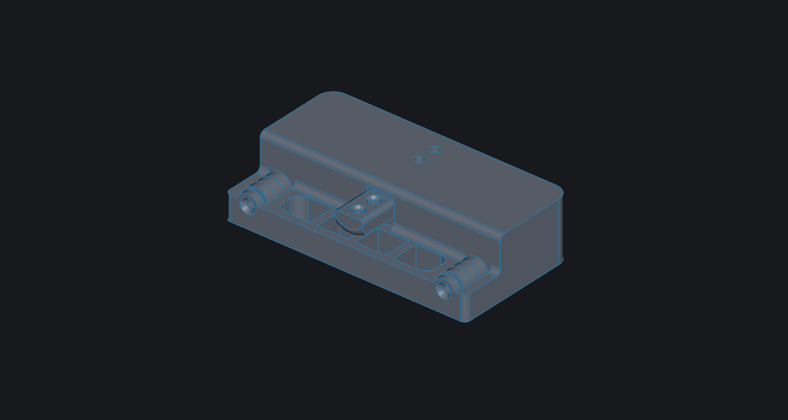
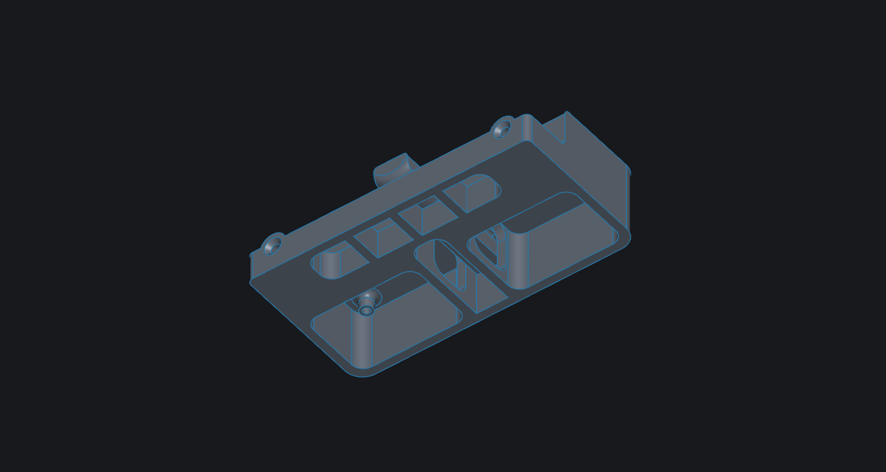

# cad/

Probe models, made in [SolidCraft](https://github.com/tangency-labs/solidcraft) 0.42.0.
Use that version or newer: older versions refuse files saved by newer ones.




| File | What |
|---|---|
| `hx2-probe.sc` | Parametric source: frame, nose, load cell, bearings, axle spacers |
| `export/hx2-probe-v1.step` | All bodies as a STEP assembly, for any CAD |
| `export/hx2-probe-v1-frame.stl` | Print: frame |
| `export/hx2-probe-v1-nose.stl` | Print: nose sleeve. It's small, so print it first to test the fit on the cell |
| `export/hx2-probe-v1-spacer.stl` | Print ×2, or cut 12 mm lengths of 5 × 3.2 mm brass or steel tube (better) |
| `export/hx2-probe-v1-coupon-posts.stl` | Fit test, about 2 g: the roof section with the posts, rib and insert holes. Print it before the frame |

The bearings in the model are drawn from the MR105ZZ datasheet dimensions (the `MR105ZZ`
component), not from a vendor file. Vendor STEP models go in `cad/parts/`, which git ignores.

## Probe v1

```
 side view, belt runs along X (into the page)
 ┌──roof, 2× M3 heat-set inserts──┐
 │  ╲_rib_╱  post rib, R2 root     │  rib underside = seat on the cell top
 │   ▼post ▼post                   │  posts locate in the cell's Ø5.35 counterbores
 │ ┌─cell (flipped)─────────────────┐
 │ └──────┐ slot      [══nose══════]┘  sleeve on the thin end; crest pushes the belt down by d
 │ bays   │ (open        ═══belt═══
 │ HX711  │  below)    ◯ MR105ZZ ×3    bearings on M3 axles in U-pockets, bumps on both walls
 └────────┘────────────────────┘
```

- **Fixed geometry, no moving parts.** The bearings sit on our side of the belt, and the nose on the far side
  (between the belts). Every height is measured from the cell's thin-end underside (z 0), so `d` follows from
  `z_post = z_n + probe_d − belt_t − brg_r`, with the nose crest at `z_n = −nose_h`.
- **Cell seat.** The flat underside of the post rib sits on the cell's top face (z = `cell_top`). Two M3 screws
  from below pull the cell up against it, so the model and the printed part agree on the cell's height.
  The Ø5.15 post tips only locate the cell, with 0.3 mm to spare above the counterbore floor.
- **Belt entry.** The belt slides in along −Y over the low front wall. The rounded front of the nose
  (fillet R = `probe_d + 0.3`) pushes the belt down by `d`.
- **Electronics.** Two bays open at the bottom, either side of the cell slot. Each takes an HX711 board
  (33.5 × 20.5 mm) on two Ø4.5 standoffs with Ø2.5 pilot holes, so M3 screws self-tap. J1 faces the cell slot,
  and the cell wires pass through the wire passages in the slot walls. The bays fit the board only for
  `probe_s` of about 72 or more.
- **Far side of the belt (between the belts):** nose crest to flange top is 7.65 mm, plus countersunk heads
  of about 0.4 mm, so about 8.1 mm in total. **Our side:** the frame is 24 mm deep and 98 mm wide.

## Print

- **Material:** PETG or ASA, not PLA (PLA creeps under steady load).
- **Frame:** back face (−Y) on the bed. The axle holes, slot, bearing pockets and standoff pilots then print
  vertically, and the posts, rib and standoffs become short horizontal stubs.
  - The longest bridges are the bay ends (37.5 mm). Use slow bridging.
  - The floor window under the channel is split by ribs, so it bridges at most about 14 mm.
- **Nose:** flange on the bed. The cavity inside bridges 9 mm.
- **Fit test first:** print `coupon-posts` and the nose, and try them on your cell. If the nose is too tight
  or too loose, change `sleeve_c` (now 0.15 mm per side).

## Assembly

1. Press 2× M3 heat-set inserts (short, Ø4 hole) into the roof from the top.
2. **Cell:** insert it from below at 30–45°, thin end first, with the nose off. Swing it level, push it up
   until its top sits on the rib, and fix it with 2× M3 (about M3×10–12, check against your cell) from below.
3. **Nose:** slide the sleeve onto the thin end until its cap touches the cell tip. Fix it with
   2× M3×6 countersunk (DIN 7991).
4. **Bearings:** for each post, slide 3× MR105ZZ onto a tube and set the stack in its pocket. Drive an
   M3×25 countersunk screw in from the front.
5. **HX711:** solder the cell wires to J1 through the wire passage. Screw the board onto its standoffs
   (M3 self-tapping), then solder the cable to J2.

## Parameters (all in the `.sc` file)

| Parameter | Value | What |
|---|---|---|
| `probe_s` | 80 | bearing spacing `s` |
| `probe_d` | 2.5 | belt deflection `d` |
| `belt_t`, `belt_w` | 1.4, 9 | belt |
| `brg_r`, `brg_w` | 5, 4 | MR105ZZ |
| `nose_h` | 3 | nose crest below the cell |
| `brg_bump`, `bump_d` | 1, 6 | inner-race bumps |
| `post_d`, `post_bot` | 5.15, 0.35 | cell posts |
| `rib_w`, `rib_h`, `rib_r` | 5.6, 2.2, 2 | post rib (cell seat) and its root fillet |
| `ins_d`, `ins_l` | 4, 3 | heat-set inserts |
| `m3_clr`, `m3_pilot`, `m3_csk` | 3.2, 2.5, 1.4 | screw holes |
| `sleeve_t`, `sleeve_c`, `flange_t`, `nose_cap`, `nose_r` | 1.2, 0.15, 1, 1.5, 1.4 | nose sleeve |
| `bay_wall`, `bay_end`, `bay_roof`, `win_inset`, `win_rib` | 3, 6, 3, 18, 3 | bays and floor window |
| `pcb_l`, `pcb_w`, `pcb_hs`, `pcb_hdx` | 33.5, 20.5, 15, 4.2 | HX711 board (spacing measured, the rest read off a photo) |
| `so_d`, `so_h` | 4.5, 5 | board standoffs |

Derived values (`z_n`, `z_post`, `y_brg`, `ch_y0`/`ch_y1`, `brick_top`/`brick_bot`, `floor_z`, `boss_top`,
`pocket_bot`, `half_w`, `so_x`, `so_y`, `nose_hw`) follow from these.

**Checked:** no interference between any bodies. Rebuilds with no errors with `probe_s` 80–100,
`probe_d` 2–3 and `nose_h` 2.5–4. Below `probe_s` of about 72 the HX711 bays are too short for the board,
and `StandoffRoots` can't build.

## Open items

- Measure the real belt path on the target printer: free straight span (≥ 100 mm), room on the far side
  of the belt (≈ 8.1 mm), and room on our side (24 mm). See [docs/risks.md §2](../docs/risks.md).
- Overload stop for the cell's thin end
- Cable exit and strain relief from the bays, and a grip
- Short-span (`probe_s` 60) variant: the board has to be turned or moved
